# Assignment 01: Git, Gitea, Git LFS, and GitHub Pages

## Student Information

- **Name:** Samreen Zia
- **Registration Number:** FA24B1-SE-067
- **GitHub Username:** samreenzia75
- **Course:** Cloud Computing (BSE-410)

## Task 1: Gitea

- **Gitea repository:** [Assignment01](http://192.168.121.129:3000/samreenzia75/Assignment01)
- **Result:** Gitea was started with Docker Compose on the Ubuntu server. The Assignment01 repository was created in Gitea, and the `main` branch was pushed successfully.

### Screenshots

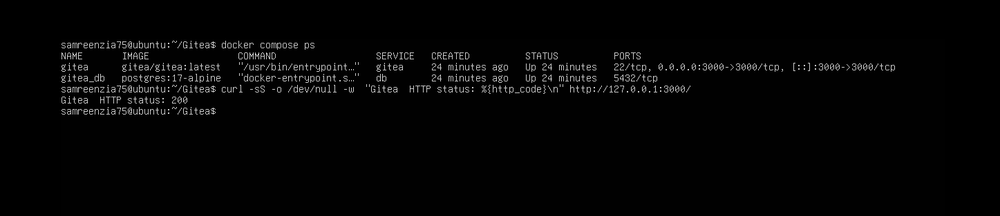

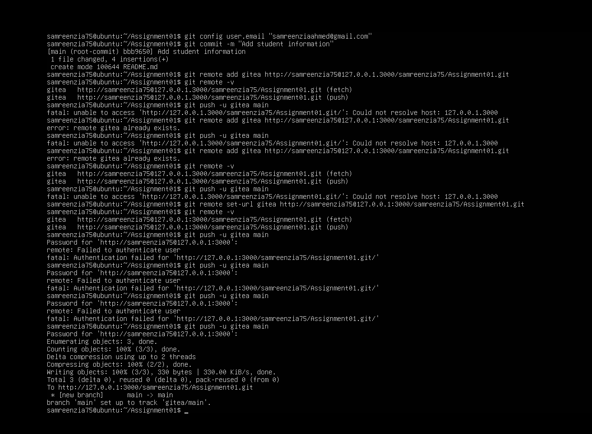

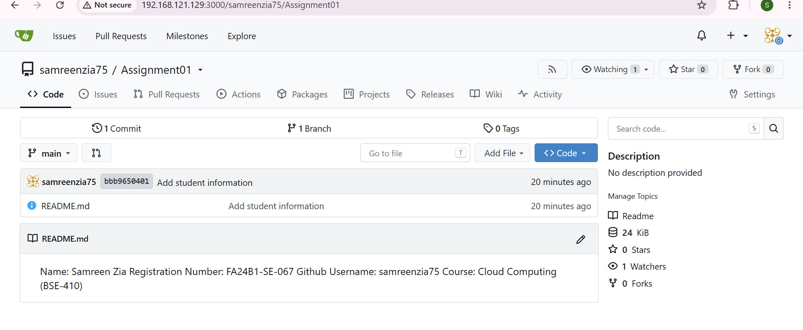

## Task 2: GitHub

- **GitHub repository:** [Assignment01](https://github.com/samreenzia75/Assignment01)
- **Result:** The GitHub remote was added to the local repository. The `main` branch was pushed successfully.

### Screenshots

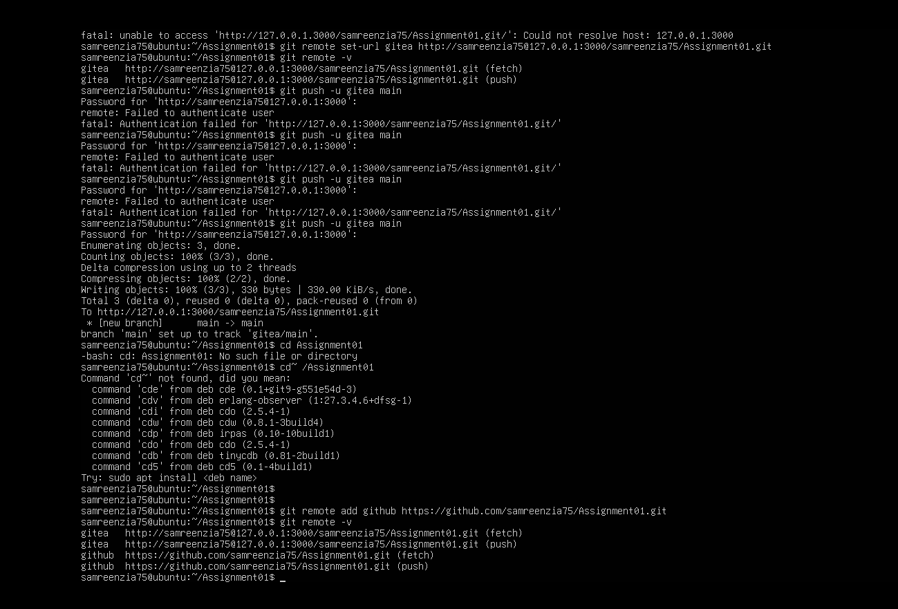

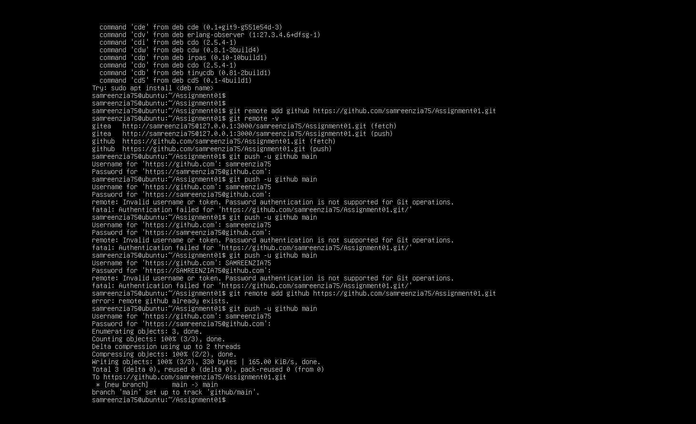

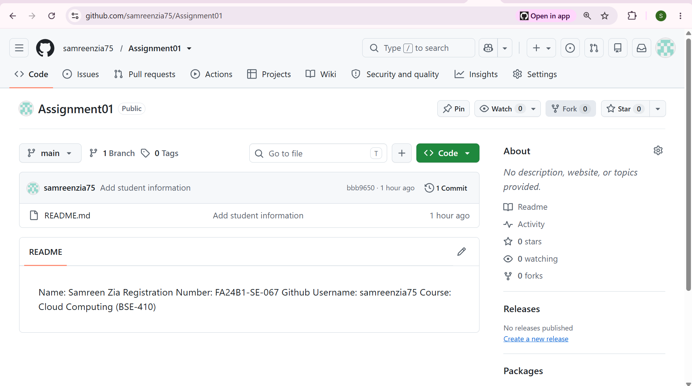

## Task 3: Git LFS

- **Tracked files:**
  - `large-file-1.bin` — 101 MiB (about 106 MB)
  - `large-file-2.bin` — 102 MiB (about 107 MB)
  - `large-file-3.bin` — 103 MiB (about 108 MB)
- **Result:** Git LFS tracked all three files. All three LFS objects and the commit were pushed successfully to GitHub.

### Screenshots

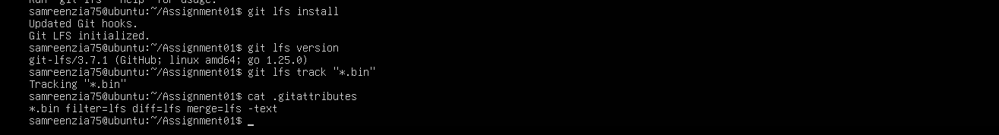

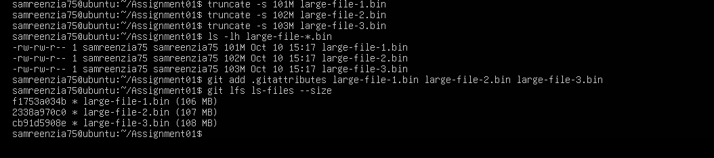

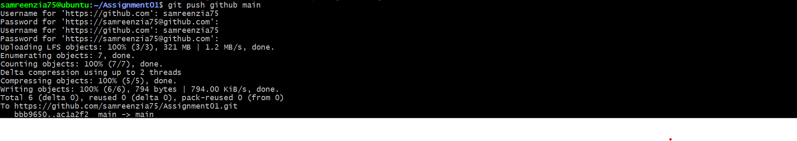

## Task 4: GitHub Pages

- **Portfolio repository:** [samreenzia75.github.io](https://github.com/samreenzia75/samreenzia75.github.io)
- **Published website:** [https://samreenzia75.github.io/](https://samreenzia75.github.io/)
- **Result:** The portfolio homepage was published using GitHub Pages.

### Screenshots

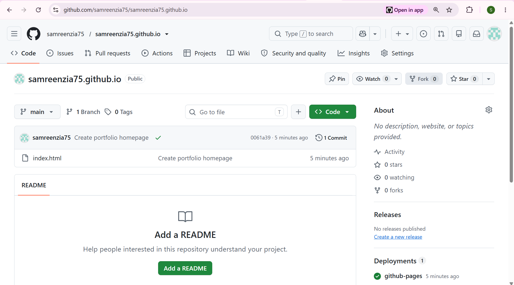

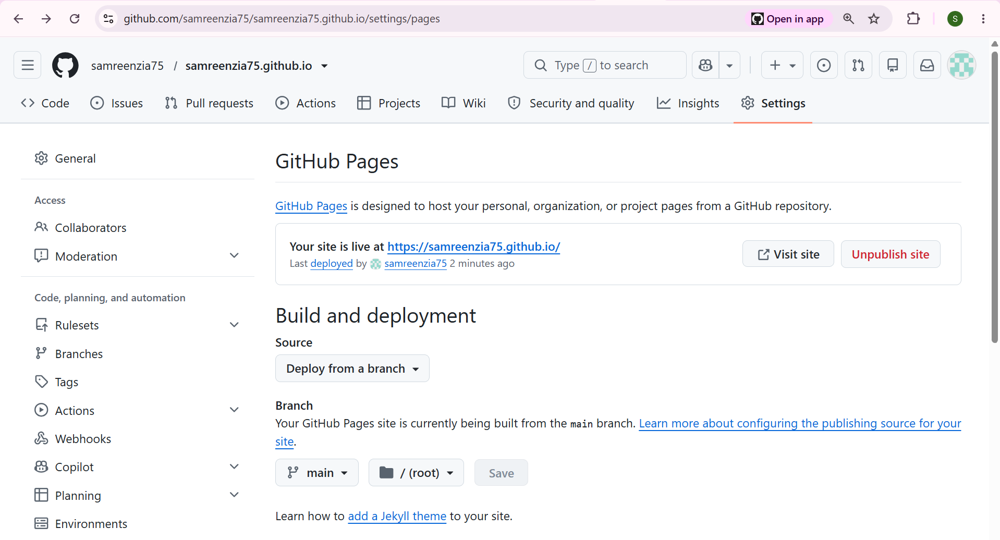

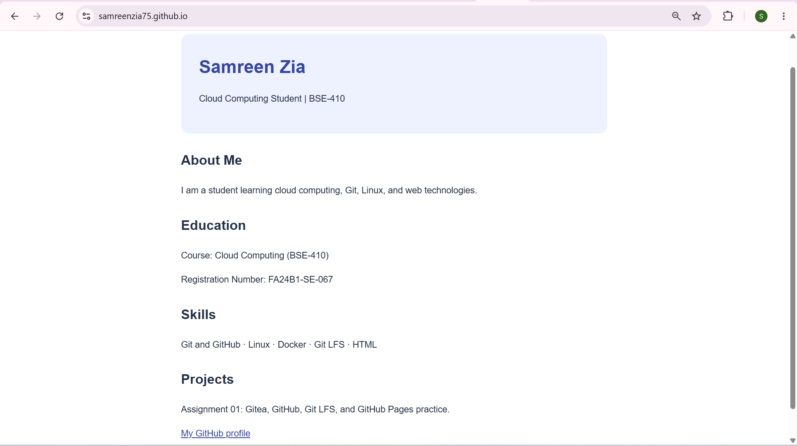
